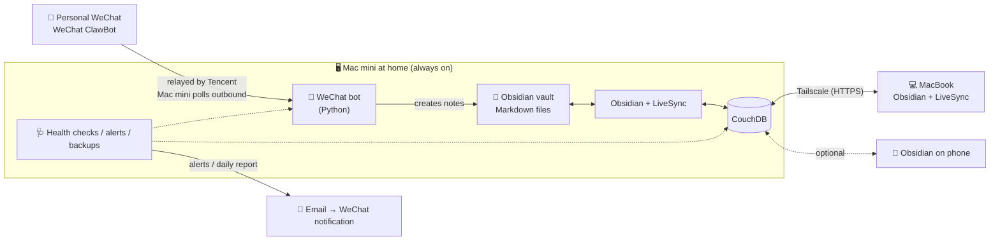

# wechat-obsidian-inbox

[简体中文](README.md) | English

**Capture notes from WeChat, keep them at home.**

Send a line of text, a voice message or a photo in **regular (personal) WeChat**, and seconds later it's a Markdown note in the Obsidian vault on a Mac mini at home — synced in real time to your laptop. No public IP, no domain, no ICP filing, and no third-party notes service in the loop.


<!-- Screenshot: wechat-capture.png — WeChat ClawBot chat, ideal as the hero image -->

## Features

- 📝 **Instant capture**: text, voice (transcribed by WeChat), photos and files from WeChat, each saved as its own Obsidian note
- 🏷️ **Auto-routing**: add a tag like `#AI` or start with a prefix and the note lands in the matching folder. Full-width `＃` from phone keyboards works too
- 📂 **Browse and edit from the chat**: `/ls`, `/search`, then append (voice works), rewrite, replace, move or delete. Edits are refused if the note changed on another device, so nothing gets overwritten
- 🔄 **Real-time multi-device sync**: Self-hosted LiveSync + your own CouchDB + Tailscale, end-to-end encrypted
- 🩺 **Runs unattended**: health check every 30 minutes with self-healing, email alerts (which can pop up in WeChat), a daily report, daily backups, and an emailed login QR code if the WeChat session expires
- 🧪 **Offline tests**: four suites with mock WeChat and SMTP servers — no real accounts needed

## Architecture



## Built with

[Obsidian](https://obsidian.md) · [Self-hosted LiveSync](https://github.com/vrtmrz/obsidian-livesync) · [Apache CouchDB](https://couchdb.apache.org) · [Tailscale](https://tailscale.com) · [Homebrew](https://brew.sh) · WeChat ClawBot plugin · Python 3 · SMTP (QQ Mail) · macOS launchd

See the [guide's hardware and software section](docs/guide.en.md#4-hardware-and-software) for what each piece does.

## Quick start

> You need an always-on Mac on macOS 15+ (Apple silicon) and a **WeChat version with the ClawBot plugin** (Me → Settings → Plugins → WeChat ClawBot).

```bash
git clone https://github.com/liyuheng800/wechat-obsidian-inbox.git ~/wechat-obsidian-inbox
cd ~/wechat-obsidian-inbox
./livesync/setup-livesync.sh   # optional: CouchDB for multi-device sync (needs Homebrew and Tailscale)
./install.sh                   # first run creates config.toml; check the vault path, run again, scan the QR code with WeChat
```

Full walkthrough — Obsidian/LiveSync setup, alert email, adding devices — in the **[guide](docs/guide.en.md)**.

> The bot's replies and the screenshots are in Chinese; every command has an English alias (`/ls`, `/search`, `/append`, `/help`…).

## Docs

| Doc | Contents |
|---|---|
| [Guide](docs/guide.en.md) | Requirements, options evaluated, architecture, software, step-by-step setup with screenshots, 12 pitfalls |
| [Usage](docs/usage.en.md) | Commands, routing rules, backups and alerts, maintenance, troubleshooting |

## License

[MIT](LICENSE)

## Disclaimer

- The WeChat ClawBot API is provided by Tencent, which reserves the right to rate-limit, block or discontinue it. The protocol implementation follows the public source of Tencent's official plugin `@tencent-weixin/openclaw-weixin`. **This project is not affiliated with Tencent**
- `config.toml`, `weixin_token.json` and similar files contain secrets; they're in `.gitignore` — never commit them to a public repository
- Built with the help of the AI assistant Claude
