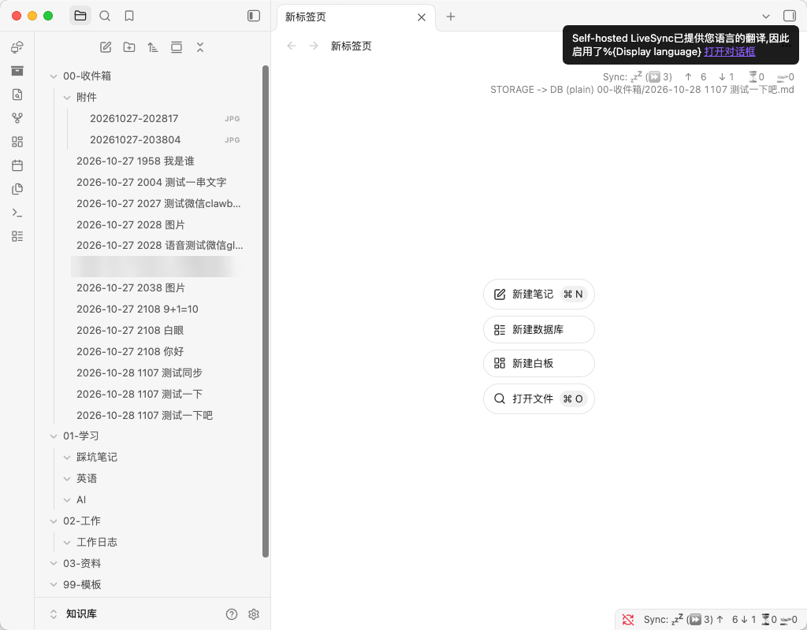
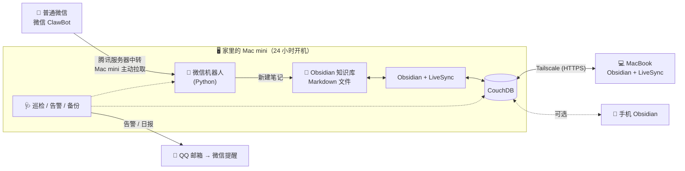

# wechat-obsidian-inbox

简体中文 | [English](README.en.md)

**用微信随手记，笔记存在自己家里。**

在**普通微信**里发一句话、一段语音或一张图，几秒后它就变成一篇 Markdown 笔记，存进家里 Mac mini 上的 Obsidian 知识库，并实时同步到你的笔记本电脑。不需要公网 IP、域名和备案，数据不经过任何第三方笔记服务。



<!-- 截图位置：wechat-capture.png —— 微信 ClawBot 对话截图，建议放在这里作为首图 -->

## 功能

- 📝 **随手记**：在微信里发文字、语音（微信自动转文字）、图片、文件，每条存成一篇独立的 Obsidian 笔记
- 🏷️ **自动归档**：带上 `#AI`、`#工作` 这类标签，或者用 `工作：` 开头，就会存进对应的文件夹。手机输入法打出的全角 `＃` 也能识别
- 📂 **在微信里查看和修改**：`/目录` 浏览、`/搜` 搜索，可以追加（支持语音）、改写、替换、移动、删除。如果笔记在别的设备上改过，修改会被拒绝，避免覆盖
- 🔄 **多设备实时同步**：Self-hosted LiveSync + 自建 CouchDB + Tailscale，秒级同步，端到端加密
- 🩺 **无人值守**：每 30 分钟巡检并自动修复，修不好的发邮件告警（可以在微信里弹出）；每天发日报、自动备份；微信会话失效时自动把登录二维码发到邮箱
- 🧪 **离线测试**：4 套测试，模拟了微信服务器和邮件服务器，不需要任何真实账号就能运行

## 架构



## 用到的软件

[Obsidian](https://obsidian.md) · [Self-hosted LiveSync](https://github.com/vrtmrz/obsidian-livesync) · [Apache CouchDB](https://couchdb.apache.org) · [Tailscale](https://tailscale.com) · [Homebrew](https://brew.sh) · 微信 ClawBot 插件 · Python 3 · QQ 邮箱 SMTP · macOS launchd

完整清单和每个软件的作用，见[搭建全记录 · 用到的软件和硬件](docs/guide.zh-CN.md#四用到的软件和硬件)。

## 快速开始

> 需要：一台 macOS 15 以上、长期开机的 Mac（Apple 芯片），以及**支持 ClawBot 插件的微信**（我 → 设置 → 插件 → 微信 ClawBot）。

```bash
git clone https://github.com/liyuheng800/wechat-obsidian-inbox.git ~/wechat-obsidian-inbox
cd ~/wechat-obsidian-inbox
./livesync/setup-livesync.sh   # 可选：安装多设备同步用的 CouchDB（需要先装好 Homebrew 和 Tailscale）
./install.sh                   # 第一次运行会生成 config.toml；确认知识库路径后再运行一次，用微信扫码绑定
```

完整步骤（包括 Obsidian / LiveSync 配置、告警邮箱、接入其他设备）请看 **[搭建全记录](docs/guide.zh-CN.md)**。

## 文档

| 文档 | 内容 |
|---|---|
| [搭建全记录](docs/guide.zh-CN.md) | 需求、选型过程、架构、用到的软件、完整搭建步骤（带截图）、12 条踩坑记录 |
| [使用说明](docs/usage.zh-CN.md) | 指令列表、自定义归档规则、备份和告警、常用命令、排错 |

## 许可

[MIT](LICENSE)

## 声明

- 微信 ClawBot 接口由腾讯提供，腾讯保留限速、拦截或停止服务的权利。本项目的协议实现参照了腾讯官方插件 `@tencent-weixin/openclaw-weixin` 的公开源码，**与腾讯官方无关**
- `config.toml`、`weixin_token.json` 等文件包含密钥，已经写进 `.gitignore`，请不要提交到任何公开仓库
- 本项目在 AI 助手 Claude 的协助下完成
