# 用微信随手记，笔记存在自己家里：Mac mini + Obsidian 本地知识库搭建全记录

简体中文 | [English](guide.en.md) · [← 返回项目首页](../README.md)

> 在**普通微信**里发一句话、一段语音或一张图，几秒后它就变成一篇笔记，存进家里 Mac mini 上的 Obsidian 知识库，并实时同步到笔记本电脑。数据不经过任何第三方笔记服务，同步全程加密，不需要公网 IP、域名，也不用备案。

这篇文章记录了我从零搭建这套系统的完整过程：需求、选型、最终方案、用到的软件、搭建步骤，以及一路踩过的坑。希望对想做类似事情的人有帮助。

---

## 目录

1. [最终效果](#一最终效果)
2. [我的需求](#二我的需求)
3. [整体架构](#三整体架构)
4. [用到的软件和硬件](#四用到的软件和硬件)
5. [选型过程：试过什么、为什么放弃](#五选型过程试过什么为什么放弃)
6. [搭建步骤](#六搭建步骤)
7. [日常使用](#七日常使用)
8. [踩坑记录](#八踩坑记录)
9. [安全与隐私](#九安全与隐私)
10. [已知限制](#十已知限制)
11. [成本](#十一成本)

---

## 一、最终效果

**随手记（手机微信）**
- 在微信的“微信 ClawBot”对话里发文字或语音，机器人回复“✓ 已存入 收件箱”。语音由微信自动转成文字
- 消息里带上标签就自动归档：`今天学了注意力机制 #AI` 存到 `01-学习/AI`，`工作：完成接口联调` 存到 `02-工作/工作日志`
- 发图片、PDF 等文件，自动保存为附件，并生成一篇带链接的笔记

**在微信里查看和修改**
- `/目录` 列出知识库，回复数字一层层打开；`/搜 关键词` 全文搜索；`/最近` 查看最近修改的笔记
- 打开笔记后可以追加（支持语音）、整篇改写、替换文字、重命名、移动、删除（删除的进回收站）

**整理（电脑上的 Obsidian）**
- Mac mini 和 MacBook 上的知识库秒级同步，在电脑上做深度整理和长文写作

**无人值守**
- 每 30 分钟自动巡检，能修复的问题自己修复，修不好的发邮件告警，邮件会在微信里弹出提醒
- 每天早上发一封日报：昨天记了多少条、系统状态是否正常
- 每天自动备份，保留 30 天
- 微信会话失效时，自动把登录二维码发到邮箱，扫码后机器人自动恢复

<!-- 截图位置：wechat-capture.png —— 微信 ClawBot 对话：发文字、语音、带标签的消息，以及机器人的回复 -->
<!-- 截图位置：wechat-browse.png —— 微信里 /目录 → 回复数字 → 打开一篇笔记 -->


*在微信里发的消息，几秒后就出现在 Mac mini 的 Obsidian 收件箱里，并上传到同步数据库（右上角 ↑6）*

---

## 二、我的需求

1. **记录要足够快**：掏出手机，在**普通微信**里说一句话或打一行字就能存下来。不想专门打开某个笔记 App，微信是我最常用的入口
2. **数据在自己手里**：笔记是普通的 Markdown 文件，存在自己家里，不依赖任何笔记公司
3. **多设备可编辑**：电脑上能随时整理，而且同一篇笔记在不同设备上修改，不能互相覆盖
4. **将来可能给家人用**，所以方案不能太脆弱
5. 家里有一台**闲置的 Mac mini（M 系列芯片，256G）**，正好用来当 24 小时在线的主机

---

## 三、整体架构

```
 ┌────────────── 手机 ──────────────┐
 │ 普通微信 → “微信 ClawBot”对话     │
 └──────────────┬───────────────────┘
                │ 消息经腾讯服务器中转
                │（Mac mini 主动拉取，不需要公网 IP）
                ▼
 ┌──────────────────── 家里的 Mac mini（24 小时开机）─────────────────────┐
 │ 微信机器人（Python）── 写入 ──▶ Obsidian 知识库（Markdown 文件）         │
 │     ▲ 浏览 / 查看 / 修改                │                               │
 │                                     Obsidian + LiveSync 插件            │
 │                                         │                               │
 │                                    CouchDB 数据库 ◀── 巡检 / 告警 / 备份 │
 └─────────────────────────────────────────┬───────────────────────────────┘
                                           │ Tailscale 加密内网（HTTPS）
                                           ▼
                    MacBook 上的 Obsidian + LiveSync（实时双向同步）
                    安卓手机上的 Obsidian（可选）
```

**几个关键设计：**

- **为什么用微信 ClawBot**：这是微信官方在 2026 年推出的插件，提供了面向个人微信号的机器人接口。消息由腾讯服务器中转，Mac mini 用 HTTPS 长轮询主动去取，所以家里的电脑**不需要被外网访问**，没有公网 IP、域名、备案这些门槛
- **机器人只新建笔记，不改已有笔记**：每条消息存成一篇独立的笔记，文件名类似 `2026-10-27 0915 注意力本质是加权求和.md`。机器人不会碰你正在编辑的文件，所以不会和多设备同步冲突。（通过 `/追加` 等指令修改笔记时，会先检查这篇笔记有没有被别的设备改过，改过就拒绝修改。）
- **为什么用 LiveSync 而不是网盘同步**：LiveSync 是实时、按数据块同步的，冲突时会提示合并，而不是悄悄生成一个“冲突副本”文件。数据库就跑在自己的 Mac mini 上，内容还有端到端加密
- **为什么用 Tailscale**：让 MacBook 和手机在任何网络下都能安全地连回家里的 Mac mini，同样不需要公网 IP，还能自动提供 HTTPS 证书

---

## 四、用到的软件和硬件

### 硬件

| 设备 | 用途 |
|---|---|
| Mac mini（Apple 芯片，256G） | 主机：知识库、同步数据库、微信机器人、巡检，24 小时运行 |
| MacBook | 用 Obsidian 整理和写作 |
| 安卓手机 | 用微信记录、查看；装 Obsidian 是可选的 |

### 软件

| 软件 | 作用 | 费用 |
|---|---|---|
| [Obsidian](https://obsidian.md) | 笔记软件，知识库就是一个装着 Markdown 文件的普通文件夹 | 个人使用免费 |
| [Self-hosted LiveSync](https://github.com/vrtmrz/obsidian-livesync)（Obsidian 社区插件） | 多设备实时同步，支持端到端加密 | 免费开源 |
| [Apache CouchDB](https://couchdb.apache.org) 3.5（通过 Homebrew 安装） | LiveSync 的同步数据库，跑在 Mac mini 上 | 免费开源 |
| [Tailscale](https://tailscale.com) | 设备间的加密内网，`tailscale serve` 自动提供 HTTPS | 个人免费 |
| [Homebrew](https://brew.sh) | macOS 包管理器，用来安装 CouchDB | 免费 |
| 微信 ClawBot 插件 | 微信官方的个人号机器人接口（需要较新版本的微信，入口：我 → 设置 → 插件） | 免费 |
| Python 3 + 本项目代码 | 微信机器人、浏览编辑、巡检、备份 | — |
| Python 依赖库 | `websockets`、`cryptography`（解密微信的图片和文件）、`certifi`（根证书）、`qrcode` + `pypng`（生成登录二维码） | 免费开源 |
| QQ 邮箱 SMTP | 发送告警和日报；配合微信的 QQ 邮箱提醒，邮件会直接弹在微信里 | 免费 |
| macOS launchd | 机器人和巡检程序开机自启、崩溃后自动重启 | 系统自带 |
| Clash Verge（可选） | 如果你开着代理，需要给 Tailscale 设置直连规则，见踩坑记录 | — |

**本项目代码**大约 2600 行 Python 和 Shell，主要模块：

| 文件 | 作用 |
|---|---|
| `bot.py` | 主程序：配置、笔记存储、标签归档、指令处理 |
| `weixin_channel.py` | 微信 ClawBot 通道：扫码登录、收发消息、媒体解密、会话失效自动重新登录 |
| `browse.py` | 在聊天里浏览、搜索、查看、修改笔记 |
| `monitor.py` | 巡检、自动修复、告警、日报、备份 |
| `notify.py` | QQ 邮箱发信 |
| `livesync/setup-livesync.sh` | 一键安装和配置 CouchDB，并开启 Tailscale HTTPS |
| `install.sh` / `uninstall.sh` | 安装和卸载后台服务 |
| `tests/` | 4 套离线测试，模拟微信服务器、邮件服务器，不需要真实账号 |

---

## 五、选型过程：试过什么、为什么放弃

这一部分可能对你最有参考价值：很多看起来可行的方案，实际都有硬门槛。

### 消息入口（核心难点：要在普通微信里用）

| 方案 | 结果 | 原因 |
|---|---|---|
| 个人微信机器人（wechaty、itchat 等非官方协议） | ❌ 放弃 | 有封号风险，不值得拿主力微信号冒险 |
| 企业微信自建应用 + 微信插件 | ❌ 走不通 | 2022 年以后新建的应用要配置“企业可信 IP”，家用宽带的 IP 会变，满足不了 |
| 企业微信“微信客服” | ❌ 走不通 | 新企业同样受可信 IP 限制，回调地址还要求是**主体一致的备案域名** |
| 企业微信“智能机器人”（API 模式，长连接） | ⚠️ 技术上可行，但最后放弃了 | 长连接不需要公网 IP，代码也写好了。但**智能机器人只能在企业微信 App 里用，个人微信里用不了**，不满足核心需求。代码里保留了这个通道 |
| 个人订阅号 | ⚠️ 不推荐 | 需要公网回调地址，只能被动回复，入口藏在“订阅号消息”里 |
| 飞书机器人 | ⚠️ 备选 | 长连接方便，功能也全，但要多装一个 App |
| flomo 等现成产品 | ⚠️ 备选 | 不用写代码，但数据先存在第三方，导入 Obsidian 也不是实时的 |
| 小程序 | ⚠️ 暂不考虑 | 交互最好，但后端必须是**已备案的 HTTPS 域名**，小程序本身也要备案，还需要一台云服务器，开发量大 |
| **微信 ClawBot（官方插件）** | ✅ **最终采用** | 官方接口，普通微信直接用，扫码绑定，不需要公网 IP 和备案，支持文字、语音（自动转写）、图片、文件 |

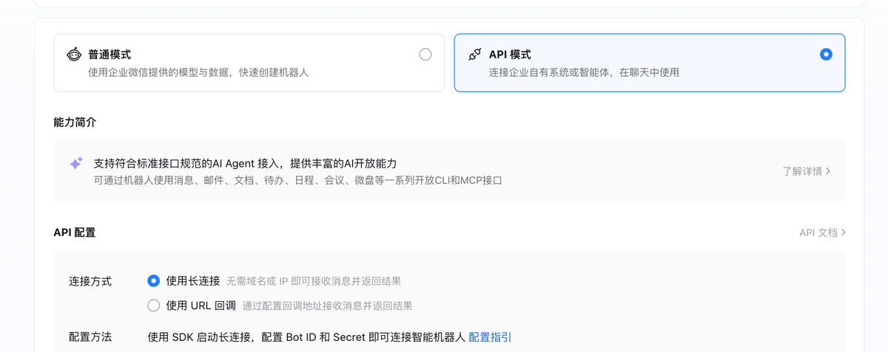

*企业微信智能机器人的 API 模式支持“长连接”，不需要域名和 IP。技术上可行，但机器人只能在企业微信里用*

> 教训：一开始我没有先确认“企业微信智能机器人能不能在个人微信里用”，就直接写代码部署了，结果卡在了最核心的需求上。**先验证最关键的约束，再动手开发。**

### 多设备同步

| 方案 | 结果 | 原因 |
|---|---|---|
| iCloud | ❌ | 手机是安卓 |
| 坚果云 + Remotely Save 插件 | ⚠️ 最初的方案，后来替换了 | 配置最简单，但数据要经过第三方，同步是分钟级的，冲突时按整个文件覆盖，多人使用时问题很多 |
| Syncthing | ⚠️ 备选 | 点对点同步，不经过云端，但官方安卓版已停止维护 |
| Obsidian 官方 Sync | ⚠️ 备选 | 最省心，但要按月付费 |
| **Self-hosted LiveSync + 自建 CouchDB + Tailscale** | ✅ **最终采用** | 数据只在自己的设备上，秒级同步，有端到端加密，冲突时会提示合并 |

---

## 六、搭建步骤

> 以下步骤以 Mac mini 作为主机。**顺序很重要：先把 Mac mini 搭成主库，再接入机器人，最后接入其他设备。**
> 文中的 `<设备名>.<tailnet>.ts.net` 要换成你自己的 Tailscale 地址。

### 第 0 步：Mac mini 系统准备

- 系统升级到 **macOS 15 或更新**（Homebrew 上 CouchDB 的预编译包需要）
- 系统设置 → 能源：打开“防止自动进入睡眠”和“断电后自动启动”
- 系统设置 → 用户与群组：打开**自动登录**（如果这个选项是灰色的，要先关闭 FileVault）。否则重启后停在登录界面，所有服务都不会启动
- 系统设置 → 通用 → 共享：打开**屏幕共享**和**远程登录**，方便以后拔掉显示器后远程管理
- 系统设置 → 通用 → 软件更新：关闭自动安装 macOS 更新
- 终端运行 `xcode-select --install`，然后按照 brew.sh 首页的说明安装 Homebrew
- 把本仓库下载到用户主目录下，例如 `~/wechat-obsidian-inbox`（`git clone` 或下载 ZIP 解压都可以）。同样不要放在“文稿”、“下载”里

### 第 1 步：Tailscale

1. Mac mini 上安装 Tailscale 并登录
2. 在 Tailscale 管理后台的 **DNS** 页面，开启 **MagicDNS** 和 **HTTPS Certificates**
3. 在 **Machines** 页面，找到 Mac mini → `…` → **Disable key expiry**（否则 180 天后密钥过期，同步会中断）

### 第 2 步：CouchDB（同步数据库）

```bash
cd ~/wechat-obsidian-inbox
./livesync/setup-livesync.sh
```

这个脚本会做这些事：安装 CouchDB；生成随机管理员密码（保存在 `~/.kb-livesync/credentials.txt`）；写入 LiveSync 需要的配置（单节点、跨域设置、只监听本机）；设置开机自启；创建数据库；用 `tailscale serve` 提供 HTTPS 地址。最后会打印出 `https://<设备名>.<tailnet>.ts.net`。

### 第 3 步：Mac mini 上的 Obsidian 主库

1. 新建仓库，位置放在用户主目录下，比如 `~/Obsidian/知识库`。⚠️ 不要放在“文稿”、“桌面”、“下载”或 iCloud 里，macOS 不允许后台程序访问这些位置
2. 安装社区插件 **Self-hosted LiveSync**，按向导操作（下面的截图是插件的中文界面）：

   ① 这是第一台设备，还没有 Setup URI，选**手动输入服务器信息**

   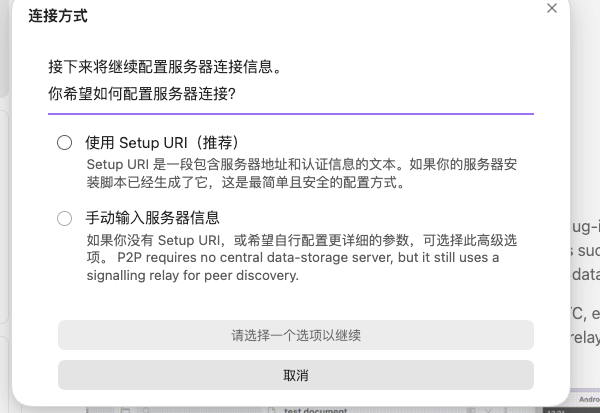

   ② 开启**端到端加密**，设置一个加密口令（务必记牢，以后每台设备都要填同一个），并勾选**混淆属性**

   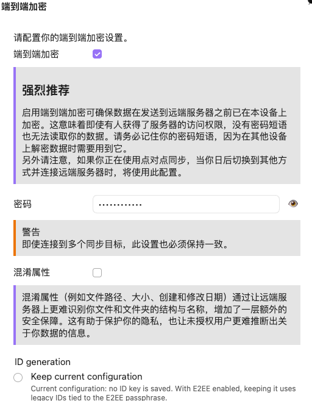

   ③ 服务器类型选 **CouchDB**

   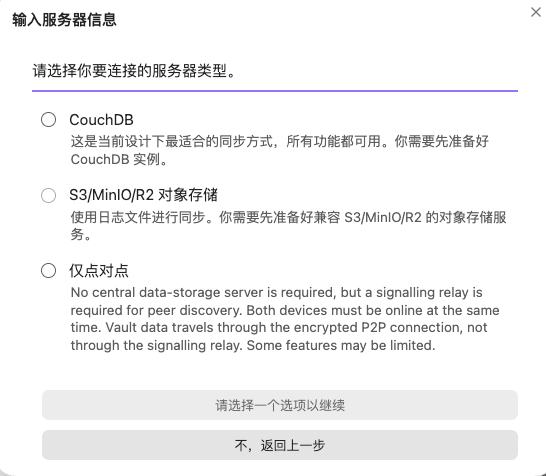

   ④ URL 填第 2 步打印的 HTTPS 地址，用户名 `admin`，密码在 `credentials.txt` 里，数据库名 `obsidian`。“使用内部 API”**不要勾**

   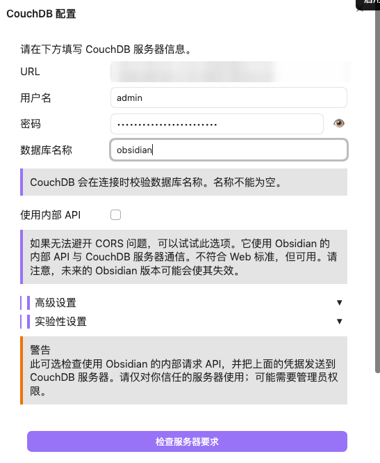

   ⑤ 点“检查服务器要求”，全部通过后点“创建或连接到数据库并继续”（如果检查失败，见踩坑记录第 5 条）

   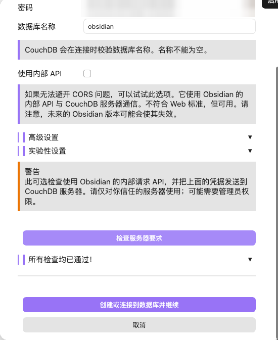

   ⑥ 选**以本机为准初始化服务器**（服务器此时是空的，不会丢任何东西）

   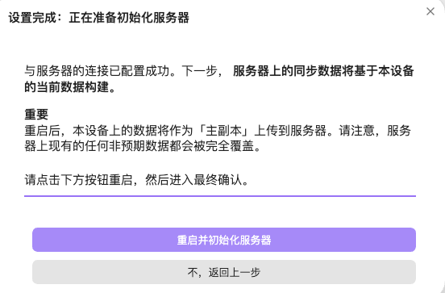
3. 同步设置里，同步模式选 **LiveSync**，打开 **Keep replication active in the background**

   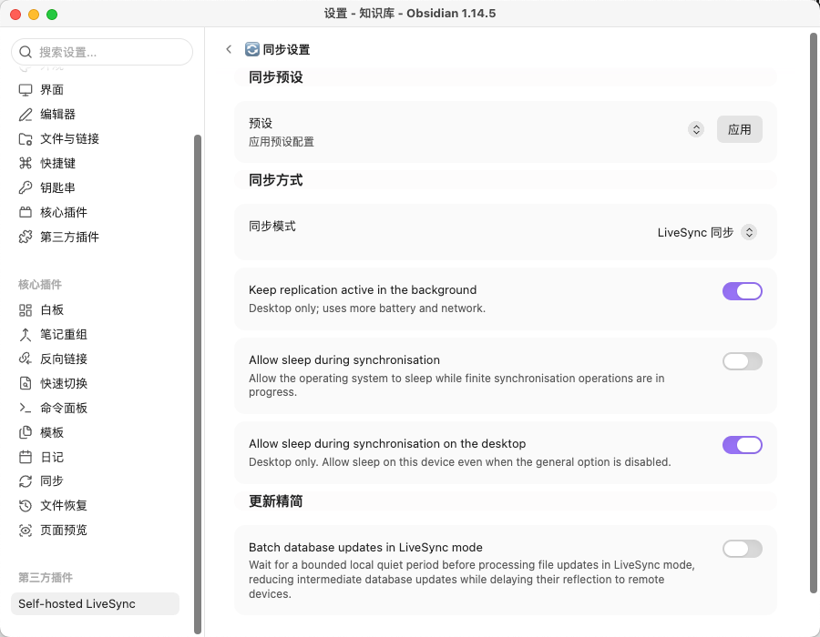

4. 把 Obsidian 加入登录项
5. 用命令面板执行“复制当前设置为 Setup URI”，保存好，给其他设备用

### 第 4 步：微信机器人

```bash
cd ~/wechat-obsidian-inbox
./install.sh          # 第一次运行会生成 config.toml 并停下来
open -e config.toml   # 确认 [vault] 里的 path 是你的知识库路径
./install.sh          # 再运行一次：终端显示二维码，用手机微信扫码并确认
```

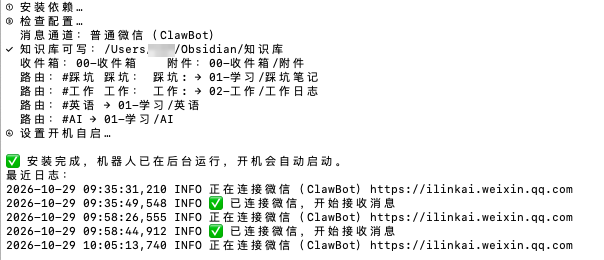

*`install.sh` 会检查配置、列出归档规则、设置开机自启，最后显示最近的日志，看到“✅ 已连接微信”就说明机器人在工作了。它可以重复运行，改完配置后再运行一次即可生效*

<!-- 截图位置：wechat-plugin-entry.png —— 微信“我 → 设置 → 插件”页面里的“微信 ClawBot” -->

前提是手机微信里能找到 **我 → 设置 → 插件 → 微信 ClawBot**。扫码绑定后，微信里会出现一个“微信 ClawBot”对话，发 `/帮助` 试试。

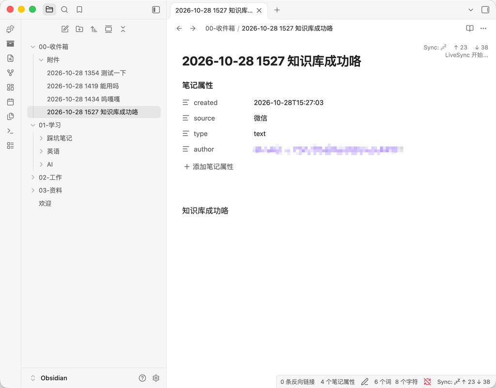

*微信里发的一句话生成的笔记：属性里记录了创建时间、来源、类型和发送人*

> 扫码这一步必须本人在“终端”App 里操作，交给自动化工具执行时脚本会跳过扫码。

### 第 5 步：告警邮箱

1. QQ 邮箱网页版 → 设置 → 账号与安全 → 开启 **POP3/SMTP 服务** → 生成**授权码**（不是 QQ 密码）
2. 在 `config.toml` 的 `[alert]` 段里填入邮箱和授权码
3. 运行 `.venv/bin/python monitor.py --test-email`，收到测试邮件就说明配置成功
4. 在微信里开启 QQ 邮箱提醒，告警会直接弹在微信里

<!-- 截图位置：daily-report.png —— 微信里收到的日报邮件 -->

### 第 6 步：接入 MacBook

1. 安装 Tailscale，用同一个账号登录
2. 安装 Obsidian，新建一个空仓库，安装 Self-hosted LiveSync
3. 在 Mac mini 上生成 Setup URI 时，会问有效期。选 **Time-bound**（限时）更安全，过期后随时可以重新生成

   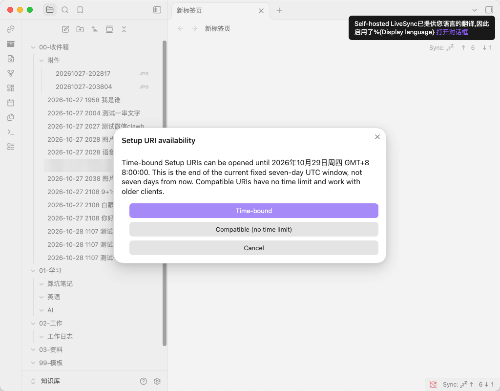

4. 在 MacBook 的向导里选 **使用 Setup URI**，粘贴后输入口令，然后：

   ① 选 **Join this device**。⚠️ **千万不要选第一项 “Initialise or overwrite the remote”**，那会用这个空仓库覆盖服务器上的全部笔记

   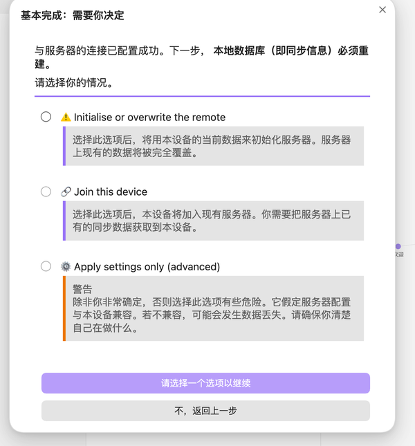

   ② 选 **Overwrite all with remote files**（只覆盖本机这个空仓库，服务器不受影响）

   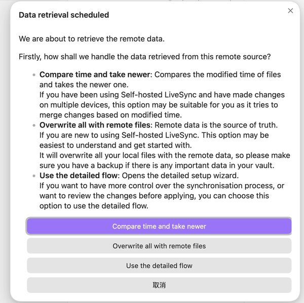

   ③ 选 **Keep local files even if not on remote**
5. 同步模式选 **LiveSync**，打开 **Keep replication active in the background**

### 第 7 步：安卓手机（可选）

步骤和 MacBook 一样。但要注意：**安卓同一时间只能运行一个 VPN**，Tailscale 和 Clash 这类代理 App 不能同时开着，需要同步时切换一下。日常记录用微信 ClawBot 就行，它不受这个限制。

---

## 七、日常使用

### 记录

| 发送 | 结果 |
|---|---|
| 直接发文字或语音 | 存进 `00-收件箱`，每条单独一篇笔记 |
| `今天学了注意力机制 #AI` | 存进 `01-学习/AI`（全角 `＃`、大小写、标签后直接接中文都能识别） |
| `工作：完成接口联调` / `踩坑：pip 要加参数` | 分别存进工作日志、踩坑笔记，并自动补上标签 |
| 图片、PDF 等文件 | 保存到附件文件夹，生成一篇带链接的笔记 |
| 长按某条消息 → 引用 → 写想法 | 笔记里同时保存你的想法和被引用的原文 |

### 指令

| 指令 | 作用 |
|---|---|
| `/今天` | 查看今天记了什么 |
| `/撤销` | 删掉刚存的那一条（已经编辑过的不会删） |
| `/目录`、`/上级` | 浏览知识库，回复数字打开 |
| `/搜 关键词`、`/最近` | 查找笔记 |
| `/追加 内容`、`/改写`、`/替换 旧=>新` | 修改当前打开的笔记 |
| `/重命名 新名称`、`/移动`、`/删除` | 整理笔记 |
| `/帮助`、`/帮助 浏览` | 查看使用说明 |

### 维护

| 操作 | 命令（在 `~/wechat-obsidian-inbox` 目录下运行） |
|---|---|
| 查看机器人日志 | `tail -f ~/Library/Logs/kb-wecom-bot.log` |
| 立即巡检（只检查，不修复） | `.venv/bin/python monitor.py --check` |
| 立即备份 | `.venv/bin/python monitor.py --backup` |
| 重新扫码绑定微信 | `.venv/bin/python bot.py --login`（机器人会自动换用新凭证，不需要重启） |
| 离线自测 | `.venv/bin/python tests/selftest_ops.py` 等 |

---

## 八、踩坑记录

这是整个过程中最花时间的部分，都已经在代码里修复了，记下来供参考。

**1. Python 无法连接企业微信，报 `python-socks` 缺失**
- 原因：电脑上开着代理软件，新版 `websockets` 库会**自动读取系统代理**，于是想走 SOCKS 代理去连接
- 解决：微信和企业微信都是国内服务，代码里默认**绕过系统代理直连**

**2. 证书验证失败 `CERTIFICATE_VERIFY_FAILED`**
- 原因：macOS 上的部分 Python（比如 python.org 的安装包）不带系统根证书
- 解决：使用 `certifi` 提供的标准根证书列表。**千万不要用关闭证书验证的方式来“解决”**

**3. 安装脚本里的 perl 崩溃：`Could not change LC_CTYPE locale to C.UTF-8`**
- 原因：运行环境的语言设置是 `C.UTF-8`，macOS 上没有这个设置
- 解决：改用 Python 修改配置文件，并在脚本开头固定一个系统里一定存在的语言环境

**4. CouchDB 没有管理员，反复启动又退出**
- 原因：Homebrew 安装的 `/opt/homebrew/etc/local.ini` 是一个**符号链接**。Python 的 `os.replace()` 会把链接本身替换成普通文件，结果配置写进了 CouchDB 根本不读的一个副本
- 解决：先用 `realpath` 找到 CouchDB 实际读取的那个文件，再在它上面修改；并在启动后**向 CouchDB 查询配置**，确认真的生效了

**5. Obsidian 连不上 `*.ts.net`**
- 原因：Obsidian 会走系统代理，而代理软件无法解析 Tailscale 的内网域名
- 解决：在 Clash Verge 里把 `*.ts.net` 和 `100.64.0.0/10` 加进“系统代理绕过”，同时添加 `DOMAIN-SUFFIX,ts.net,DIRECT` 和 `IP-CIDR,100.64.0.0/10,DIRECT` 两条前置规则。如果“代理绕过”改不了，先关掉“使用默认绕过”

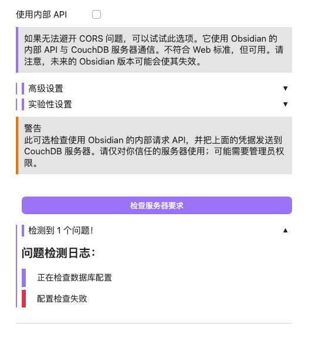

*代理拦截时，LiveSync 只会显示一句笼统的“配置检查失败”*

<!-- 截图位置：clash-verge-bypass.png —— Clash Verge 系统代理绕过的设置页 -->

**6. LiveSync 显示已连接，但实际上没在同步**
- 现象：状态栏一直显示方块图标，`↑0 ↓0`
- 原因：新设备的同步模式默认是“事件触发时”，而下面的触发开关全是关的；另外，没有打开后台同步的话，Obsidian 窗口一切到后台就会暂停同步
- 解决：同步模式改成 **LiveSync**，并打开 **Keep replication active in the background**。正常运行时状态栏显示 `zzZ`（待命），传输时显示 ⚡

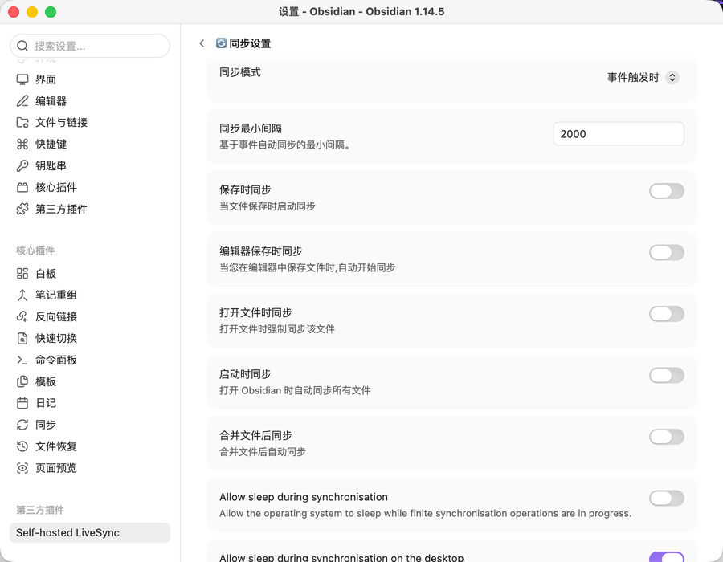

*新设备上默认是“事件触发时”，而且所有触发开关都是关的，等于完全不同步*

**7. 用 `#AI` 标签发的消息没有归档**
- 原因：手机输入法打出的是**全角 `＃`**
- 解决：全角、半角统一处理，标签不区分大小写，标签后面直接跟中文（比如 `#AI测试`）也能识别

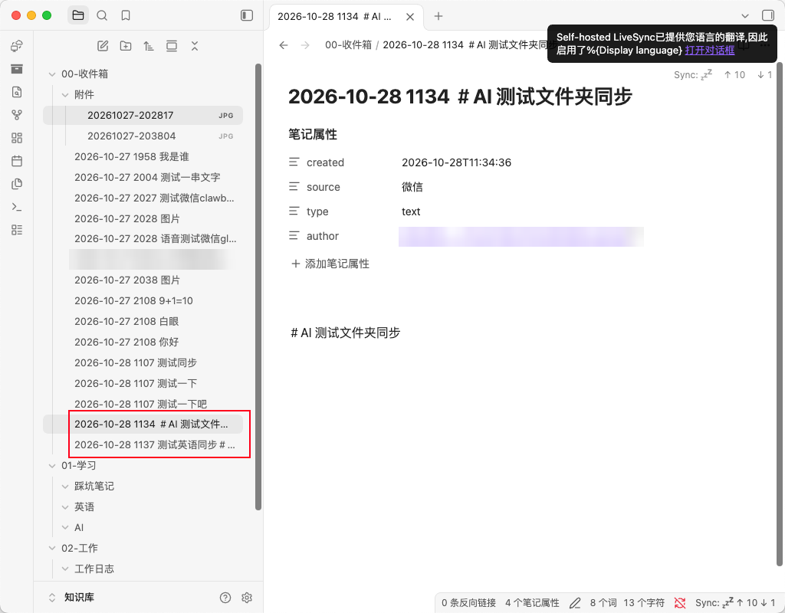

*红框里两条带全角“＃”的消息留在了收件箱，正文里的标签也没有变成 Obsidian 的紫色标签*

**8. 其他设备上看不到空文件夹**
- 原因：LiveSync 只同步文件，**不同步空文件夹**
- 结论：这是正常现象，文件夹里有了第一篇笔记就会出现

**9. 扫了离线测试生成的二维码，微信提示无效**
- 原因：自测程序用的是模拟服务器的假二维码
- 解决：自测不再显示二维码；正式扫码时会打印链接，可以用它来辨认真假

**10. 安卓上 Tailscale 和代理不能同时开**
- 原因：安卓系统同一时间只允许运行一个 VPN
- 结论：需要同步时切换一下；或者换用能同时跑代理和 Tailscale 的 App（比如 sing-box 较新的版本）

**11. 重启后服务全都没有起来**
- 原因：机器人、数据库、Obsidian 都要在**用户登录后**才会启动
- 解决：打开自动登录（需要先关闭 FileVault），再把锁屏设为“立即需要密码”，锁屏不会影响后台服务运行

**12. 同步不等于备份**
- LiveSync 会把误删或者改坏的内容同步到所有设备。所以加了每日打包备份，有条件的话再接一块移动硬盘开 Time Machine

**13. 大视频只在 Mac mini 上有，别的设备收不到**
- 现象：微信发了一段 20 多分钟的视频，Mac mini 上能看到，MacBook 上只有笔记，点开链接反而生成了一个空的 `xxx.mp4.md`
- 原因：LiveSync 默认**跳过 50 MB 以上的文件**（设置项 Maximum file size），超过的既不上传也不下载，而且不会提示
- 解决：每台设备都打开 设置 → General → Enable advanced features，再到 🚦 Selector → Normal Files 把 Maximum file size 调大（比如 1024）。大视频会在每台设备和数据库里各存一份，空间紧张的话宁可保持限制

---

## 九、安全与隐私

- **数据在哪**：笔记文件在 Mac mini 和你自己的设备上；同步数据库在 Mac mini 上，内容有端到端加密，开启混淆后服务器上连文件名都看不到
- **网络暴露**：CouchDB 只监听本机地址，外部设备只能通过 Tailscale 内网的 HTTPS 访问，不暴露到公网
- **微信机器人**：只接收扫码绑定的那个微信号发来的消息；浏览功能只能访问知识库文件夹，隐藏文件夹不显示；修改前会检查笔记是否被其他设备改过；删除的笔记进回收站
- **密钥文件**：`config.toml`（邮箱授权码）、`weixin_token.json`（微信凭证）、`~/.kb-livesync/credentials.txt`（数据库密码）权限都设成仅自己可读，**千万不要提交到 Git**（仓库里已经配好 `.gitignore`）
- **微信 ClawBot 接口**由腾讯提供，腾讯保留限速、拦截或停止服务的权利。本项目的协议实现参照了腾讯官方插件 `@tencent-weixin/openclaw-weixin` 的公开源码，与腾讯官方无关

---

## 十、已知限制

- 微信 ClawBot **只能回复，不能主动推送**，所以告警只能走邮件
- 微信里没有可点击的按钮，浏览靠“编号列表 + 回复数字”；图片和附件不能在微信里直接预览
- Mac mini 上的 Obsidian 需要一直开着，机器人新存的笔记靠它同步出去
- 目前只支持**一个人**使用。多人使用需要按人分区，并给每个人分别绑定 ClawBot，属于后续计划
- 备份和知识库在同一块硬盘上，防不了硬盘损坏，需要额外的移动硬盘或者 MacBook 上的同步副本兜底

---

## 十一、成本

| 项目 | 费用 |
|---|---|
| 硬件 | 用的是闲置的 Mac mini，额外 0 元。Mac mini 待机功耗很低 |
| 软件和服务 | Obsidian（个人免费）、LiveSync / CouchDB（开源）、Tailscale（个人免费）、微信 ClawBot（免费）、QQ 邮箱（免费） |
| 时间 | 大约 2 天，其中大部分花在选型和踩坑上。照着这篇文档做，**一个下午**应该就够了 |

---

## 后续计划

- 开放给家人：按人分区，加一个家庭共享区
- 解决安卓上 Tailscale 和代理的冲突，在手机上直接用 Obsidian
- 更多标签和自动整理规则

---

*本项目在 AI 助手的协助下完成：方案设计和代码由 Claude 协助编写，Mac mini 上的安装步骤由本地 AI 代理 Hermes 执行，并在每个关键步骤停下来等待人工确认。*
